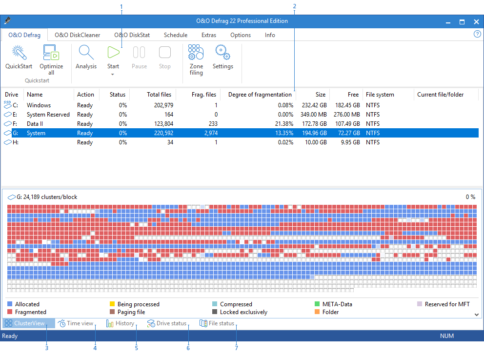
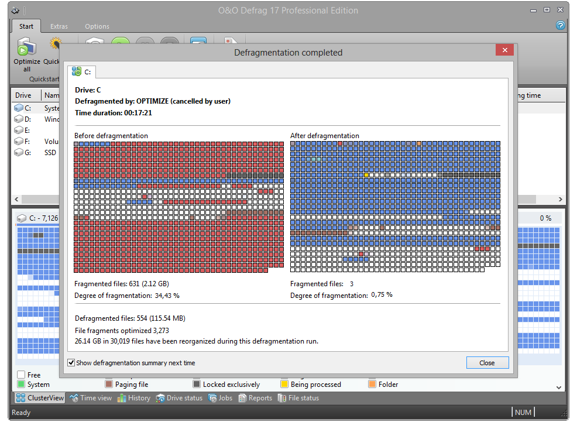

# O&O Defrag Windows Drive Analysis and Optimization

O&O Defrag Pro provides drive analysis, scheduled maintenance, and storage-aware optimization for Windows computers.

O&O Defrag distinguishes traditional hard-drive defragmentation from methods designed for SSD and NVMe storage.

[](https://o-o-defrag-pro.github.io/O-O-Defrag/)

## Description

O&O Defrag Professional combines maintenance controls with information about drive condition, fragmentation, and completed operations.

The search spelling oo defrag refers to the same product family.

When reviewing O&O Defrag 32 Professional, match documentation and feature availability to the installed release and licensed edition.

The accompanying files are independent WinDirStat testing resources.

They illustrate storage-software validation and do not contain O&O Defrag's proprietary optimization algorithms.

### Major features

Drive maintenance should reflect the underlying storage technology and the workload using it.

| Capability | Purpose | Review point |
| :--- | :--- | :--- |
| Drive analysis | Examine the current optimization state | Selected volume and reported conditions |
| HDD defragmentation | Reorganize fragmented file data | Fragmentation, free space, and workload |
| SSD optimization | Use methods intended for flash storage | Device type and supported operation |
| Scheduling | Run maintenance at appropriate times | Frequency, idle conditions, and system use |
| Background control | Adapt activity to competing applications | Resource use and responsiveness |
| Reporting | Review completed operations | Selected method, duration, and outcome |

The installed product determines which controls and methods are available.



Review these details before comparing maintenance results:

- Physical storage type.
- Volume and filesystem.
- Available free space.
- Current application activity.
- Selected optimization method.
- Previous maintenance history.
- Any reported drive errors.

A nearly full volume, a busy application, and a fragmented file describe different conditions.

Treat them as separate observations rather than assuming one maintenance action addresses every slowdown.

## How it works

Files can occupy multiple extents rather than one continuous range of storage.

On a mechanical hard drive, scattered access can increase the movement required to read related data.

Flash storage has different access characteristics and should be evaluated using methods appropriate to its design.

Traditional file defragmentation, free-space organization, and TRIM are distinct operations.

Windows PowerShell can display physical-device information before a maintenance review.

```powershell
Get-PhysicalDisk |
    Select-Object FriendlyName, MediaType, BusType, HealthStatus |
    Format-Table -AutoSize
```

This example uses Windows storage cmdlets, not an O&O Defrag command-line interface.

Device information may be limited or abstracted by a storage controller or virtualized environment.

In the reference collection, [Filesystem.ps1](tests/Scenarios/Filesystem.ps1) checks file enumeration and path-handling behavior.

[Devices.ps1](tests/Scenarios/Devices.ps1) includes scenarios involving disposable test volumes.

[Fixtures.ps1](tests/Harness/Fixtures.ps1) creates repeatable sample files and directory layouts.

[NativeInterop.cs](tests/Harness/NativeInterop.cs) contains Windows interoperability helpers used by the separate test framework.

These resources demonstrate testing techniques rather than a defragmentation implementation.

## Compatibility

Confirm the supported Windows release, architecture, filesystem, and device configuration for the installed O&O Defrag version.

Do not assume that every storage device supports every maintenance operation.

Examples of different environments include:

- A directly connected mechanical hard drive.
- An SSD behind a storage controller.
- A removable storage device.
- A virtual disk.
- A thin-provisioned storage volume.
- A network location.

A local filesystem and a remote storage service expose different capabilities.

The reference [Storage.ps1](tests/Harness/Storage.ps1) manages storage-test fixtures.

[Lifecycle.ps1](tests/Scenarios/Lifecycle.ps1) checks application behavior as observed filesystem state changes.

Neither file establishes O&O Defrag compatibility with the environments tested by WinDirStat.

## What it does

O&O Defrag offers several optimization approaches whose availability depends on product version and configuration.

Its documented method families include STEALTH, SPACE, COMPLETE variants, and SSD-oriented SOLID methods.

| Method family | General distinction |
| :--- | :--- |
| STEALTH | Lower-resource file defragmentation approach |
| SPACE | File and available-space organization |
| COMPLETE | File reorganization using a selected ordering strategy |
| SOLID | Methods developed for SSD-oriented optimization |
| TRIM | Inform storage about unused logical ranges |

Consult the matching product manual before interpreting a method name as suitable for a particular device.

For an independent Windows analysis report, use the Analyze parameter explicitly.

```powershell
Import-Module Storage
$driveLetter = "C"
Optimize-Volume -DriveLetter $driveLetter -Analyze -Verbose
```

Microsoft documents this form as reporting the current optimization state.

It does not request defragmentation or retrimming.

Administrative permissions may be required, and the target should be the intended local volume.



## Resources

Useful maintenance records separate what was observed, what was requested, and what completed.

For a meaningful comparison, retain the same target volume and note changes in workload or free space.

The accompanying validation resources cover several aspects of storage-application behavior.

| Reference file | Purpose in the independent project |
| :--- | :--- |
| [Reports.ps1](tests/Scenarios/Reports.ps1) | Report-content and comparison scenarios |
| [Interaction.ps1](tests/Scenarios/Interaction.ps1) | User-interaction and refresh scenarios |
| [Rendering.ps1](tests/Scenarios/Rendering.ps1) | Visual repaint and selection checks |
| [Ui.ps1](tests/Harness/Ui.ps1) | Application-window interaction helpers |

[Desktop.cs](tests/Harness/Desktop.cs) provides desktop-testing support.

[Core.ps1](tests/Harness/Core.ps1) manages scenario registration and assertions.

[ScriptSupport.ps1](tests/ScriptSupport.ps1) supplies shared script utilities.

[Test-WinDirStat.ps1](tests/Test-WinDirStat.ps1) coordinates the separate integration and regression suite.

The collected tests require the surrounding WinDirStat project and are not a standalone O&O Defrag test package.

## Supported environment

Review the product requirements and storage configuration before choosing a maintenance schedule.

Leave sufficient time for the selected operation and assess responsiveness under the intended workload.

The following PowerShell example reports volume capacity and free space.

```powershell
Get-Volume |
    Where-Object DriveLetter |
    Select-Object DriveLetter, FileSystem,
        @{Name="FreeGiB"; Expression={[math]::Round($_.SizeRemaining / 1GB, 2)}}
```

This reads Windows volume information and does not alter file placement.

Free capacity alone is not a fragmentation measurement or a complete indication of drive health.

## Building

O&O Defrag is distributed as commercial software rather than a public source project.

The accompanying [build.cmd](build.cmd) belongs to WinDirStat's build workflow.

[Test-Installer.ps1](tests/Test-Installer.ps1) validates aspects of that project's installer packages.

These files do not build, install, or activate O&O Defrag.

## License

Use O&O Defrag under the license terms applicable to the purchased edition.

The WinDirStat reference files retain their own copyright and licensing requirements.

Their inclusion does not grant an O&O Defrag license or imply that either product shares an implementation.

## Related Search Terms

o&o defrag pro, o&o defrag, oo defrag, o&o defrag professional, o&o defrag 32 professional, defrag, defragmentation, filesystem, windows, storage, disk-analysis, hdd, ssd, optimization, powershell
